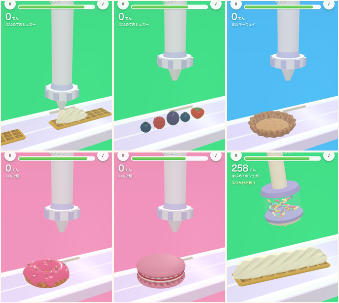

# 完璧なクリーム 3D

ベルトに乗って流れてくるワッフルやタルト、フルーツにクリームを絞るブラウザゲームです。全10ステージ。1分間でお菓子を仕上げ、最後の5秒で自分が絞ったクリームにトッピングします。



## 遊び方

1. タイトルの「ステージをえらぶ」から始めます。
2. お菓子の先端がノズルの真下に来たら画面を長押しし、後端で離します。マウスなら左ボタンを使います。塗り残し、はみ出し、盛りすぎが採点に影響します。
3. フルーツが一列に並んで来たら、先頭から最後の一粒まで押し続けて塗れます。次のお菓子との間では離してください。
4. 仕上げでは画面をタップすると、マシーンがトッピングを落とします。最後に塗ったお菓子には、絞った筋も塗り残しもそのまま残ります。

獲得したコインはショップでクリームやトッピングと交換できます。ステージの進行や購入内容はブラウザに保存されます。BGMは5曲からステージごとにシャッフルして再生します。

## ローカルで起動する

Node.js と npm を使います。開発・テストで確認した環境は Node.js 26.13.0 です。リポジトリのルートで実行してください。

```sh
npm ci
npm run dev
```

ターミナルに表示されたURLを開きます。標準の開発用URLは [http://127.0.0.1:5173/](http://127.0.0.1:5173/) です。

## 本番ビルドとSFTPでの公開

```sh
npm run build
npm run preview
```

`build` は型チェック後に配布用ファイルを `dist/` に生成します。`preview` で表示されたURLを開くと、アップロード前に同じビルドで遊べます。

SFTPでは **`dist/` の中身をすべて**、公開したいディレクトリへ転送してください。たとえば公開先が `/game/` なら、配置は次のとおりです。

```text
game/
├── index.html
├── assets/
├── audio/
└── models/
```

公開先の `/game/` をブラウザで開きます。公開サーバーは静的ファイルを配信できれば十分です。初回は読み込みアニメーションが表示され、お菓子とマシーンのモデルがそろうとタイトルに切り替わります。

## 開発とテスト

```sh
npm test
npm run typecheck
```

ゲームはTypeScriptとBabylon.jsで実装し、Viteでビルドしています。

| 変更したい箇所 | 主なファイル |
| --- | --- |
| 絞った量・塗り残し・スコアの判定 | [src/logic/cream.ts](src/logic/cream.ts) |
| フルーツの列やお菓子の登場順 | [src/game/menu.ts](src/game/menu.ts) |
| ステージ進行と仕上げ | [src/game/game.ts](src/game/game.ts) |
| 絞ったクリームの形 | [src/scene/creamMesh.ts](src/scene/creamMesh.ts) |
| ノズルとトッピングマシーンの動き | [src/scene/dispensers.ts](src/scene/dispensers.ts) |

## Blenderモデルの再生成

生成済みモデルは [public/models/](public/models/) に同梱しています。形状を編集するときは、Blender 5.3で次のスクリプトを実行します。お菓子の形を変えたら、クリームが乗る表面のデータも再生成してください。

```sh
blender -b -P scripts/blender/build_sweets.py
blender -b -P scripts/blender/bake_icing_surfaces.py
```

トッピングマシーンと絞り口の断面は、それぞれ個別に再生成できます。

```sh
blender -b -P scripts/blender/build_topping_station.py
blender -b -P scripts/blender/build_piping.py
```

プレビュー画像を作るには `blender -b -P scripts/blender/render_previews.py -- --samples 32 --res 420` を実行します。
